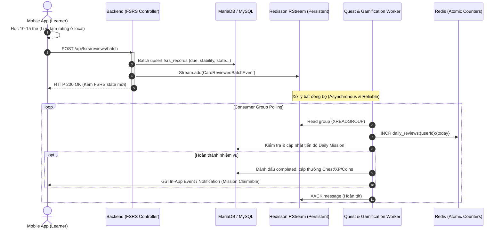

# Quyết định kiến trúc (ADR): Cơ chế Học FSRS & Tích hợp Nhiệm vụ Bất đồng bộ với Redisson

- **Trạng thái**: Đã duyệt (Accepted)
- **Ngày**: 2026-10-14
- **Tác giả**: SnapVocab Core Team
- **Liên quan đến**: `FsrsRecord`, `DailyMission`, `Redisson`, Spaced Repetition (SRS)

---

## 1. Bối cảnh & Vấn đề (Context & Problem Statement)

SnapVocab triển khai thuật toán **FSRS (Free Spaced Repetition Scheduler)** để cá nhân hóa lịch ôn tập từ vựng cho từng người học (Learner). Khi người học lật và đánh giá thẻ (`AGAIN`, `HARD`, `GOOD`, `EASY`):

1. Hệ thống cần tính toán lại lịch ôn (`due`), độ ổn định (`stability`), độ khó (`difficulty`), số lần lặp (`reps`), số lần quên (`lapses`) và cập nhật vào cơ sở dữ liệu (`fsrs_records`).
2. Đồng thời, hành động học thẻ kích hoạt nhiều hệ thống vệ tinh:
   - Cập nhật tiến độ **Daily Mission** (ví dụ: _"Ôn tập 10 từ hôm nay"_, _"Hoàn thành 1 bài học"_).
   - Tích lũy **XP** và duy trì **Streak**.
   - Cập nhật **Leaderboard**.

### Nguy cơ nghẽn & sập hệ thống (Bottleneck):

- Nếu xử lý đồng bộ (Synchronous HTTP call & DB Transaction) cho từng lượt lật thẻ:
  - Một user lật thẻ mỗi 3-5 giây. Với 1.000 user đồng thời, hệ thống phải gánh 200 - 330 write requests/giây.
  - Mỗi request mở transaction cập nhật `fsrs_records`, sau đó query kiểm tra điều kiện nhiệm vụ, cập nhật bảng nhiệm vụ $\rightarrow$ **Gây nghẽn Connection Pool, Lock Contention và Crash Database**.
- Nếu dùng **Redis Pub/Sub** thông thường: Message không được lưu trữ bền vững (In-memory Fire-and-Forget). Nếu server restart hoặc worker bận, **message bị mất vĩnh viễn**, dẫn đến user học nhưng không được ghi nhận nhiệm vụ / XP.
- Nếu dùng **Apache Kafka**: Quá cồng kềnh, tốn kém tài nguyên (RAM, CPU, Zookeeper/KRaft) không cần thiết ở giai đoạn hiện tại.

---

## 2. Quyết định kiến trúc (Decision)

Áp dụng mô hình **Local Batching ở Client** kết hợp **Event-Driven Asynchronous Processing sử dụng Redisson (Redis Streams / Reliable Queue)** ở Backend.

### 2.1. Phân tách ranh giới dữ liệu (Data Isolation)

- `TopicItem`: Chỉ chứa **Content** (Từ vựng, phiên âm, định nghĩa, ví dụ...). Được chia sẻ chung cho toàn bộ người dùng trong các Collection hệ thống (`CollectionType.SYSTEM`).
- `FsrsRecord`: Thực thể độc lập lưu **Tiến độ học cá nhân** theo cặp `(user_id, topic_item_id)`.
- Khi user chưa học từ nào trong Topic, hệ thống áp dụng cơ chế **Lazy Init** (`LEFT JOIN` khi truy vấn, nếu `FsrsRecord` chưa có thì xem như trạng thái `NEW`, không sinh record rỗng trước).

### 2.2. Gom mẻ ở Client (Client-Side Batching)

- Client (Mobile) quản lý session học tại local (State / MMKV).
- Khi kết thúc phiên học (hoặc user bấm thoát giữa chừng, hoặc cứ mỗi mẻ 5-10 từ): Mobile gửi 1 request batch duy nhất lên API:
  `POST /api/fsrs/reviews/batch`
- Giảm thiểu **90% - 95%** số lượng request mạng và DB transactions.

### 2.3. Bất đồng bộ hóa Nhiệm vụ bằng Redisson Streams (Zero Message Loss)

- Luồng chính (FSRS Review API) chỉ làm 2 việc:
  1. Ghi nhận batch vào `fsrs_records` trong MySQL/MariaDB.
  2. Đẩy một sự kiện `CardReviewedEvent` vào **Redisson Stream** (`RStream`) hoặc **Redisson Blocking Queue** (`RBlockingQueue`).
  3. Trả về HTTP 200 ngay lập tức (Latency mục tiêu: **< 30ms**).
- Luồng phụ (Worker / Consumer):
  - Chạy ngầm trong ThreadPool riêng biệt (hoặc cụm worker scale độc lập).
  - Đọc event từ Redis, cập nhật tiến độ nhiệm vụ (Daily Mission), XP, Streak.
  - Sử dụng cơ chế **ACK (Acknowledgment)**: Message chỉ được xóa khỏi Redis Stream khi worker xử lý và commit xong. Nếu worker crash giữa chừng, message sẽ được redeliver cho worker khác $\rightarrow$ **Đảm bảo 100% không mất dữ liệu**.

---

## 3. Kiến trúc luồng dữ liệu (Architecture Flow)



---

## 4. Chi tiết triển khai kỹ thuật (Technical Specifications)

### 4.1. Thư viện FSRS Core

- Tích hợp thư viện chuẩn Java của tổ chức Open Spaced Repetition:
  ```xml
  <dependency>
      <groupId>io.github.open-spaced-repetition</groupId>
      <artifactId>fsrs</artifactId>
      <version>1.0.0</version>
  </dependency>
  ```
- FSRS Engine Service:

  ```java
  @Service
  public class FsrsEngineService {
      private final Scheduler scheduler = Scheduler.builder().build();

      public CardStateResult calculateNextReview(FsrsRecord current, Rating rating, Instant reviewTime) {
          Card card = mapToFsrsCard(current);
          CardAndReviewLog result = scheduler.reviewCard(card, rating, reviewTime);
          return mapToRecordState(result.card());
      }
  }
  ```

### 4.2. Khai báo Event & Redisson Stream

- **Stream Key**: `stream:events:flashcard_reviewed`
- **Consumer Group**: `group:gamification_processors`
- **Payload Event (`CardReviewedBatchEvent`)**:
  ```json
  {
    "eventId": "uuid-v4",
    "userId": 1001,
    "topicId": 142,
    "reviewedCount": 10,
    "timestamp": 1728939600000,
    "ratings": {
      "AGAIN": 1,
      "HARD": 2,
      "GOOD": 6,
      "EASY": 1
    }
  }
  ```

### 4.3. Consumer Worker với Auto-Ack & Error Handling

```java
@Component
@Slf4j
public class GamificationStreamConsumer {

    private final RedissonClient redisson;
    private final DailyMissionService dailyMissionService;
    private final StreakService streakService;

    @Scheduled(fixedDelay = 500)
    public void pollEvents() {
        RStream<String, Object> stream = redisson.getStream("stream:events:flashcard_reviewed");
        StreamReadGroupArgs args = StreamReadGroupArgs.neverDelivered().count(50);

        Map<StreamMessageId, Map<String, Object>> messages =
            stream.readGroup("group:gamification", "consumer-1", args);

        for (Map.Entry<StreamMessageId, Map<String, Object>> entry : messages.entrySet()) {
            try {
                CardReviewedBatchEvent event = parseEvent(entry.getValue());

                // 1. Cập nhật Daily Mission
                dailyMissionService.onCardsReviewed(event.getUserId(), event.getReviewedCount());

                // 2. Cập nhật Streak
                streakService.recordStudyActivity(event.getUserId());

                // 3. XACK sau khi xử lý thành công
                stream.ack("group:gamification", entry.getKey());
            } catch (Exception ex) {
                log.error("Failed to process event: " + entry.getKey(), ex);
                // Message không được ACK -> nằm trong PEL (Pending Entries List) để retry sau
            }
        }
    }
}
```

---

## 5. Đánh giá ưu điểm & Nhược điểm (Trade-offs)

### Ưu điểm:

1. **Khả năng chịu tải cực cao (High Throughput)**:
   - Tách rời hoàn toàn luồng học thẻ (I/O latency cực thấp) khỏi luồng Gamification.
   - Nhờ client batching và Redis Stream, database MySQL chỉ chịu < 5% tải so với cách tiếp cận thông thường.
2. **Không mất dữ liệu (Reliability)**:
   - Redis Streams lưu trữ log trên disk (theo cấu hình RDB/AOF của Redis) và dùng cơ chế ACK. Nếu server restart hoặc crash, các message chưa ACK sẽ được xử lý lại đầy đủ.
3. **Tiết kiệm hạ tầng**:
   - Sử dụng hạ tầng Redis sẵn có thông qua Redisson, không tốn tài nguyên cài đặt và giám sát cụm Kafka.
4. **Dễ dàng mở rộng (Future-proof)**:
   - Kiến trúc Event-driven cho phép dễ dàng cắm thêm các tính năng mới trong tương lai (ví dụ: gửi Push Notification, cập nhật League bảng xếp hạng, phân tích dữ liệu AI) mà không chạm vào code của FSRS Review.

### Nhược điểm & Cách kiểm soát:

- **Eventual Consistency**: Điểm thưởng nhiệm vụ có thể hiển thị trễ hơn hành động lật thẻ khoảng 0.2 - 0.5 giây.
  - _Giải pháp_: Client khi submit batch thành công có thể hiển thị trước hiệu ứng chúc mừng (optimistic feedback), sau đó nhận cập nhật quest mới nhất qua response hoặc polling nhẹ.
- **Quản lý kích thước Stream**: Stream trong Redis nếu không dọn dẹp sẽ chiếm RAM theo thời gian.
  - _Giải pháp_: Giới hạn độ dài Stream với cờ `MAXLEN ~ 100000` (giữ lại 100k event gần nhất sau khi đã ACK).
